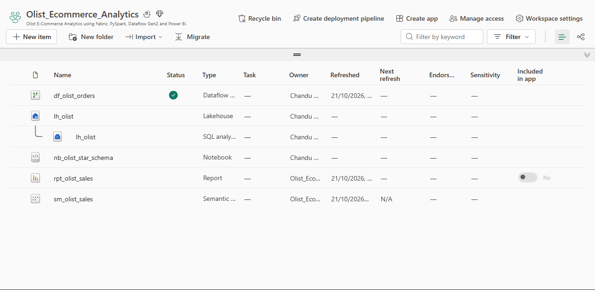
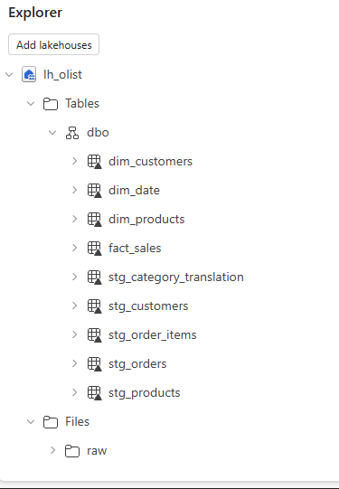
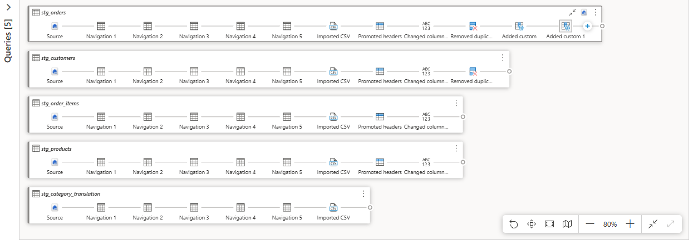
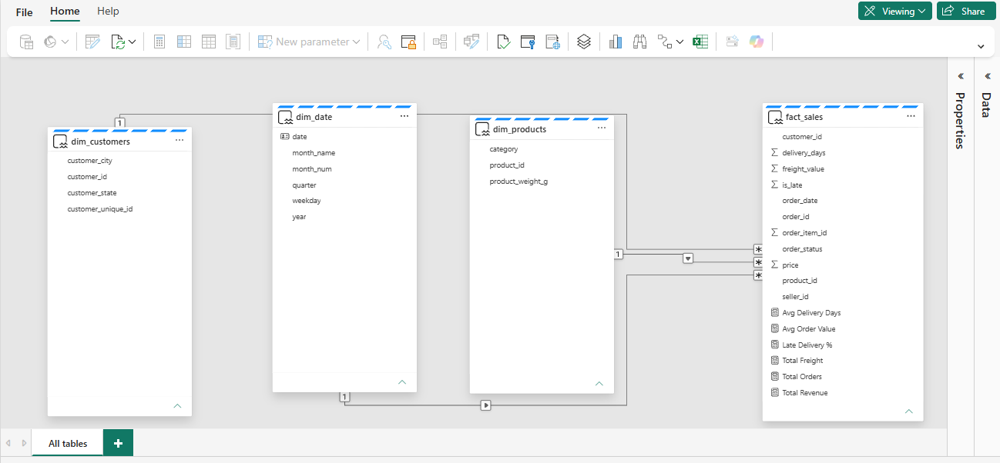
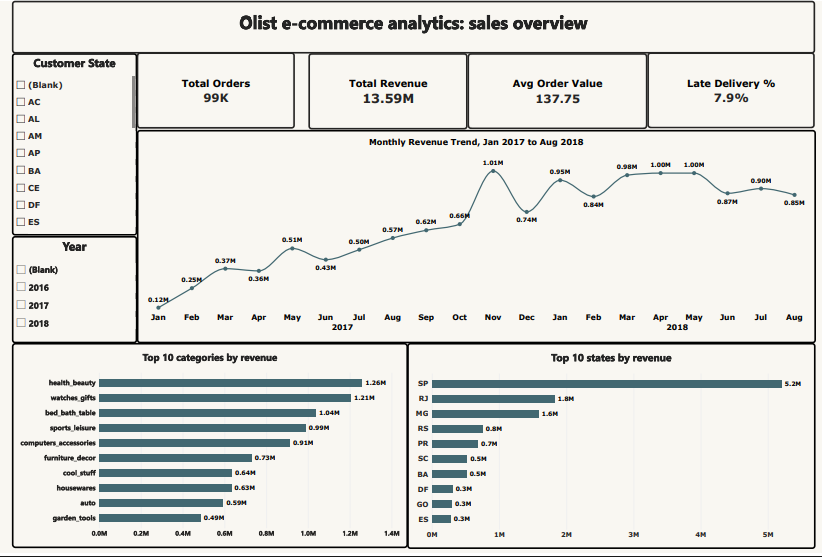
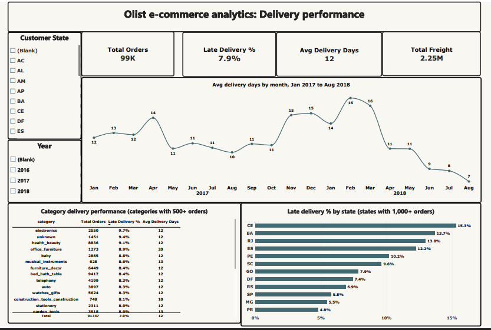

# 🛒 Olist E-commerce Analytics on Microsoft Fabric

End-to-end e-commerce analytics project built using Microsoft Fabric, PySpark, Dataflow Gen2, and Power BI to analyze sales performance and delivery reliability across Brazil.

## 🧩 Business Problem

E-commerce businesses need to understand what drives revenue and where delivery performance falls short. This project answers two key questions:

- **What drives sales?** Which product categories and states generate the most revenue?
- **How reliable is delivery?** Which states and product categories experience more late deliveries?

## 🔍 Key Findings

| Metric | Result |
|---|---:|
| Total revenue | R$13.59M |
| Total orders | 98,666 |
| Average order value | R$137.75 |
| Late delivery rate | 7.9% |
| Average delivery time | About 12 days |
| Top revenue category | health_beauty — R$1.26M |
| Highest late-delivery rate among qualifying states | Ceará (CE) — 15.3% |
| Lowest late-delivery rate among qualifying states | Paraná (PR) — 4.8% |

### Sales Insights
- Monthly revenue peaked at approximately R$1.0M in November 2017.
- health_beauty was the leading category by revenue.
- São Paulo (SP) generated the most revenue.

### Delivery Insights
- About 7.9% of delivered order items arrived late.
- Late-delivery rates ranged from 4.8% in Paraná to 15.3% in Ceará among states with at least 1,000 orders.
- office_furniture had an average delivery time of approximately 20 days.

## 🛠️ Tech Stack

- **Microsoft Fabric:** Lakehouse, Dataflow Gen2
- **Data Engineering:** PySpark, Delta tables
- **Data Modeling:** Star schema, semantic model
- **Analytics:** Power BI, DAX, SQL
- **Data Source:** Olist Brazilian E-commerce Dataset (Kaggle)

## 🏗️ Data Architecture

| Component | Fabric Item | Purpose |
|---|---|---|
| Storage | `lh_olist` | Raw files and curated tables |
| Ingestion | `df_olist_orders` | Loads and cleans source data |
| Transformation | `nb_olist_star_schema` | Builds the star schema |
| Semantic model | `sm_olist_sales` | Relationships and DAX measures |
| Reporting | `rpt_olist_sales` | Sales and delivery dashboards |

## 🧱 Data Model

- **fact_sales:** 112,650 order-item rows
- **dim_customers:** Customer city and state
- **dim_products:** Product categories and weights
- **dim_date:** Date, year, quarter, month, and weekday

The model uses dimension-to-fact relationships with single-direction filtering.

## ⚙️ Key DAX Measures

```DAX
Total Revenue = SUM(fact_sales[price])

Total Orders = DISTINCTCOUNT(fact_sales[order_id])

Avg Order Value = DIVIDE([Total Revenue], [Total Orders])

Total Freight = SUM(fact_sales[freight_value])

Avg Delivery Days = AVERAGE(fact_sales[delivery_days])

Late Delivery % =
DIVIDE(
    CALCULATE(
        COUNTROWS(fact_sales),
        fact_sales[is_late] = 1
    ),
    CALCULATE(
        COUNTROWS(fact_sales),
        NOT(ISBLANK(fact_sales[is_late]))
    )
)
```

## 📊 Dashboard Screenshots

### 1. Microsoft Fabric Workspace


### 2. Lakehouse Tables


### 3. Dataflow Gen2


### 4. Semantic Model


### 5. Sales Overview


### 6. Delivery Performance


## 📄 Dashboard Report

View the exported Power BI report containing the Sales Overview and Delivery Performance dashboards.

[**View Dashboard PDF**](https://github.com/chandu2627/Olist_Ecommerce_Analytics/blob/main/rpt_olist_sales.pdf)

## 🚀 How to Reproduce

1. Download the [Olist dataset from Kaggle](https://www.kaggle.com/datasets/olistbr/brazilian-ecommerce).
2. Create a Microsoft Fabric workspace and Lakehouse named `lh_olist`.
3. Upload the required CSV files to `Files/raw`.
4. Create the Dataflow Gen2 staging tables and apply the cleaning steps.
5. Run `nb_olist_star_schema.ipynb` with the Lakehouse attached.
6. Create the semantic model, relationships, and DAX measures.
7. Build the Sales Overview and Delivery Performance report pages.

## 📝 Data Notes

- Revenue uses item price and excludes freight; currency is Brazilian reais (R$).
- The dataset ends in September 2018, so the latest delivery trends may be understated.
- Category analysis uses categories with more than 500 orders.
- State analysis uses states with more than 1,000 orders.
- Products with missing categories are labeled `unknown`.

## 🔮 Future Improvements

- Analyze the relationship between delivery delays and customer reviews.
- Add payments and sellers to the data model.
- Automate refreshes using a Fabric pipeline.

## 📚 Dataset

[ Brazilian E-Commerce Public Dataset by Olist — Kaggle](https://www.kaggle.com/datasets/olistbr/brazilian-ecommerce)

---

**Project:** Olist E-commerce Analytics on Microsoft Fabric  
**Focus:** E-commerce Analytics | Data Engineering | Business Intelligence  
**Tools:** Microsoft Fabric | PySpark | Power BI | DAX | SQL

